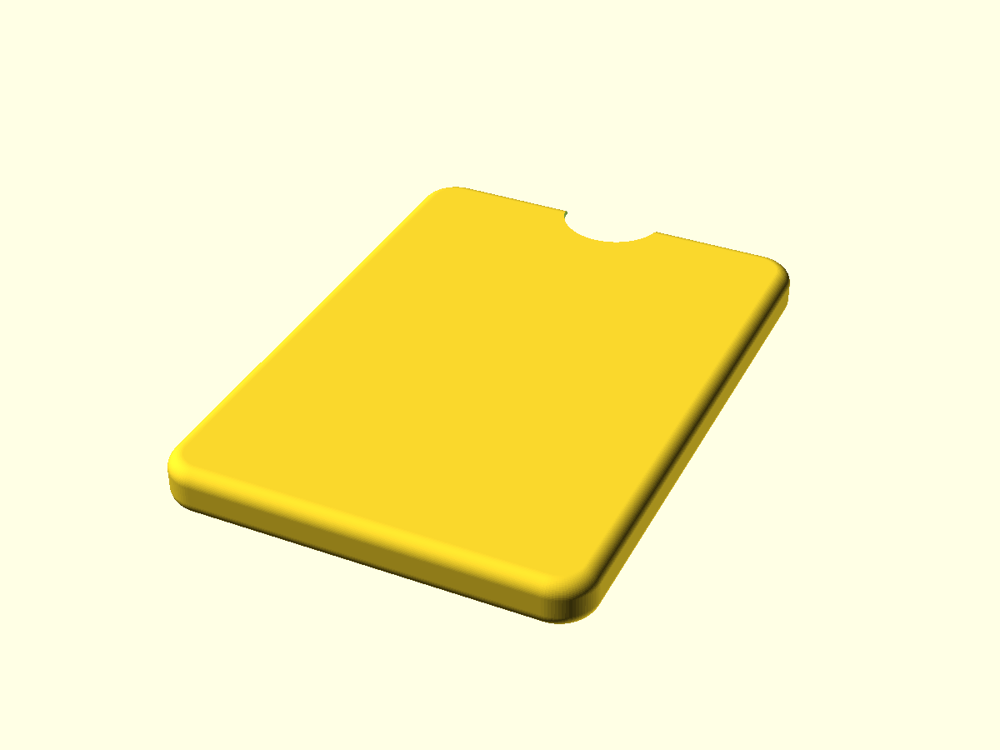

# vibe-design

Parametric 3D-printable designs written in [OpenSCAD](https://openscad.org), built with Claude Code and printed on an Elegoo/Ender 3 Plus.

Each folder is one design. Open the `.scad` file in OpenSCAD, tweak the parameters at the top, then export an STL (F6, then F7).

## Designs

| Folder | What | Material | Preview |
| --- | --- | --- | --- |
| [`bikegrips/`](bikegrips) | Lock-on bicycle grips (sleeve only, reuses the metal lock rings), hex-pocket pattern, engraved logos | TPU |  |
| [`kindlecase/`](kindlecase) | Kindle shell and test ring | PETG |  |

Each folder's README is generated from the `.scad` header comments plus a render (see Previews).

## Conventions

- `*.scad` sources are the truth. STLs are exports and may lag behind.
- Gcode is not committed (printer and filament specific).
- `test_*.scad` files cut a small test piece out of the full design with no parameter overrides, so tuning stays in the main file.

## Previews

Each project folder has its own `previews.sh`. It renders every `.scad` except `test*.scad` to `previews/<name>.png` and refreshes the generated section of that folder's `README.md` (the leading `//` comment of each `.scad` becomes its description):

```
cd bikegrips && ./previews.sh          # PNGs
cd bikegrips && ./previews.sh --stl    # also re-export STLs
```

Needs OpenSCAD (found on `PATH` or in `/Applications`).

## Notes

- The Claude and OpenAI marks in `bikegrips/logos/` are trademarks of their owners, included for personal use only.
