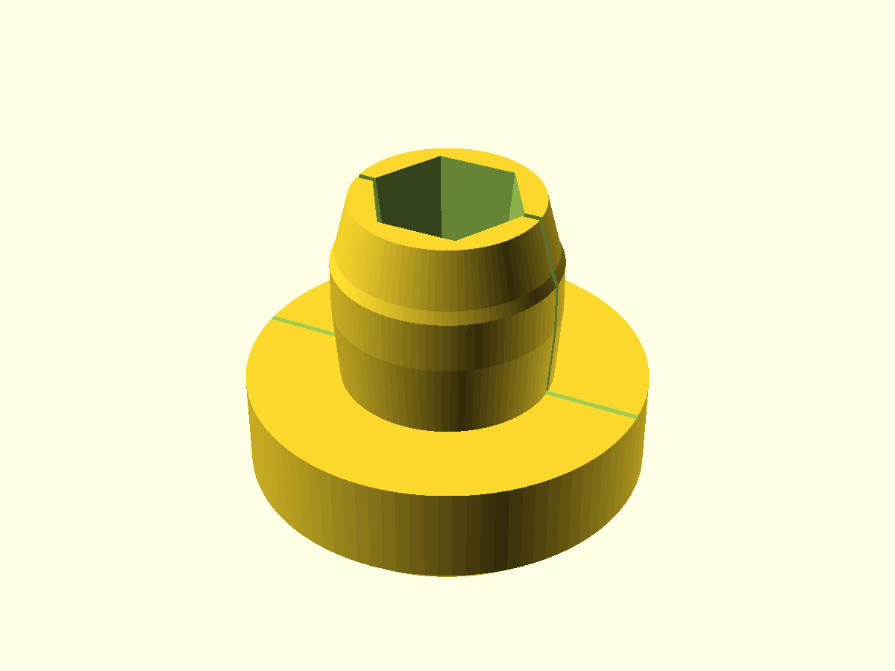
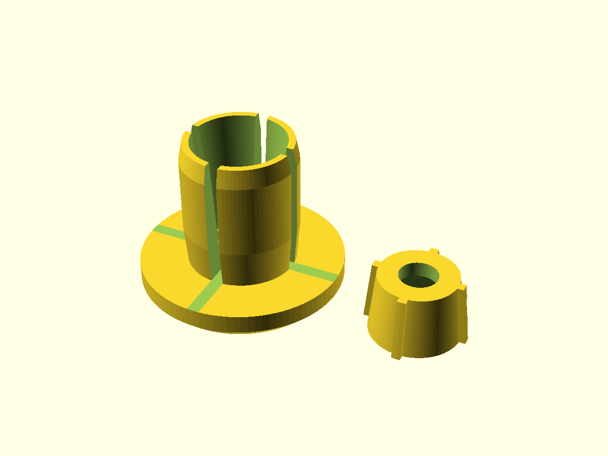
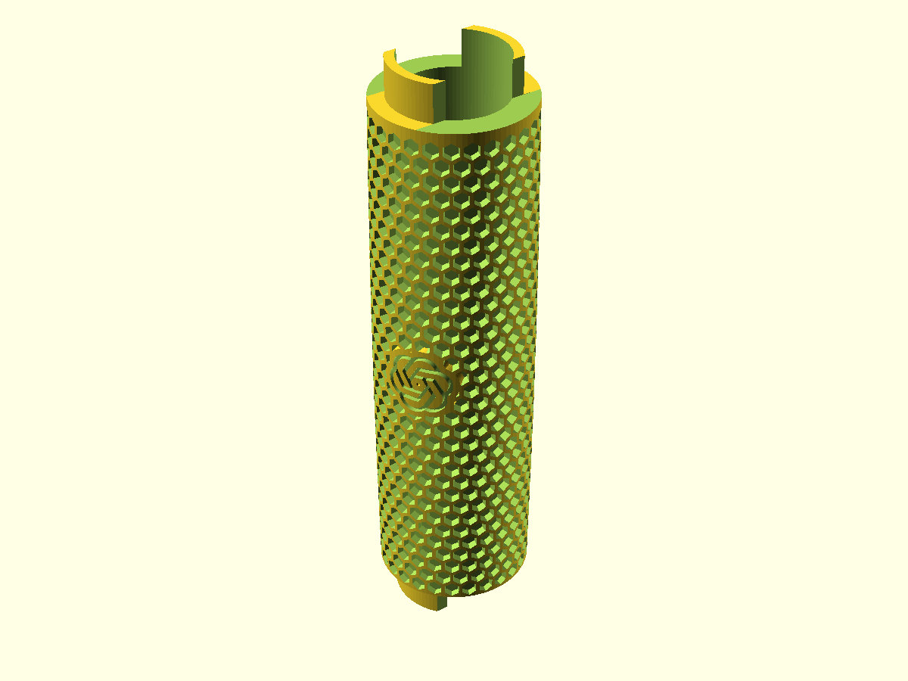

# bikegrips


<!-- previews:start (generated by previews.sh, do not edit) -->
### barend_onepiece.scad

```text
One-piece version (fallback, see barend.scad for the two-piece expanding plug).
Bar-end plug for the lock-on grip: an expanding plug that goes into the open end of the
handlebar, a wide head that matches the grip, and an M6 countersunk bolt + nut that spread
the slit plug against the bar wall.
Remade from Barend.stl (Thingiverse), section measured from the file, with a 33 mm head
to match the fat grip. Values marked [STL] come from that file.

  head (thick, wide)   cone seat for a countersunk screw (11.6 mm at the face, narrowing to the shaft, 90 deg), then the straight 6 mm hole
  plug (thin, long)    tapered M6 nut pocket in the tip, slit: tightening the bolt pulls the nut
                       into the taper and spreads the plug against the tube

Printed head down (outer face on the bed, plug pointing up), so neither the counterbore nor the
nut pocket needs support. Assembly: bolt through the head, nut loose in the plug tip, then
push the plug into the tube and tighten. Axis along Z.
```



### barend.scad

```text
Expanding bar-end plug for the lock-on grip, two pieces:
  sleeve  the wide head (33 mm, matches the grip) + a plug cut by crossed slits (four petals) with a conical bore
  wedge   a cone with the M6 nut in a closed cavity (slid in from the side, back wall behind it);
          fins slide in the slits so it cannot spin
An M6 countersunk screw goes in through the head, through the wedge and into the nut.
Tightening it pulls the wedge into the sleeve and spreads the plug against the tube wall.
Remade from Barend.stl (Thingiverse); head and plug sizes follow that file, the wedge is new.
Values marked [STL] come from that file. barend_onepiece.scad is the simpler fallback.

layout = "print"      both parts side by side, ready to print (default)
         "sleeve"     the sleeve alone   } to export each part as its own STL:
         "wedge"      the wedge alone    }   openscad -D 'layout="wedge"' -o wedge.stl barend.scad
         "assembled"  wedge pulled into the sleeve, to check the fit
Print the sleeve head down and the wedge on its back wall (big face), so nothing needs support. PETG.
Assembly: slide the nut into the wedge from the side, push the wedge into the plug tip with the
fins in the slits, then screw in from the head. Unscrewing drives the nut against the back wall
and pushes the wedge out of the cone.
Screw: M6 x 30 countersunk. The sleeve is 26 mm long, so the tip passes through the nut and
sticks out ~4 mm; with the wedge pulled in all the way it ends up ~13 mm past the nut, fine.
```



### lockon_grip.scad

```text
Lock-on bicycle grip, sleeve only (print in TPU).
Reuses the metal lock rings from the original grip: 22.2 mm bar bore, a ring
seat with two straight-sided lips at each end, a barrel-shaped body (thicker in
the middle) covered in deep hex pockets, and Claude / OpenAI logos engraved into
the pattern with a solid border.
Parameters marked [MEASURE] still need checking against the real part.

Print standing up (grip axis along Z). test_grip.scad prints just one end.
```



<!-- previews:end -->
