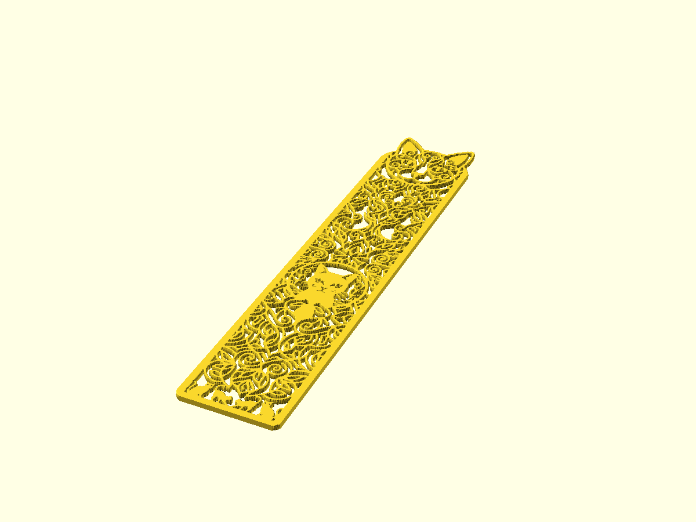
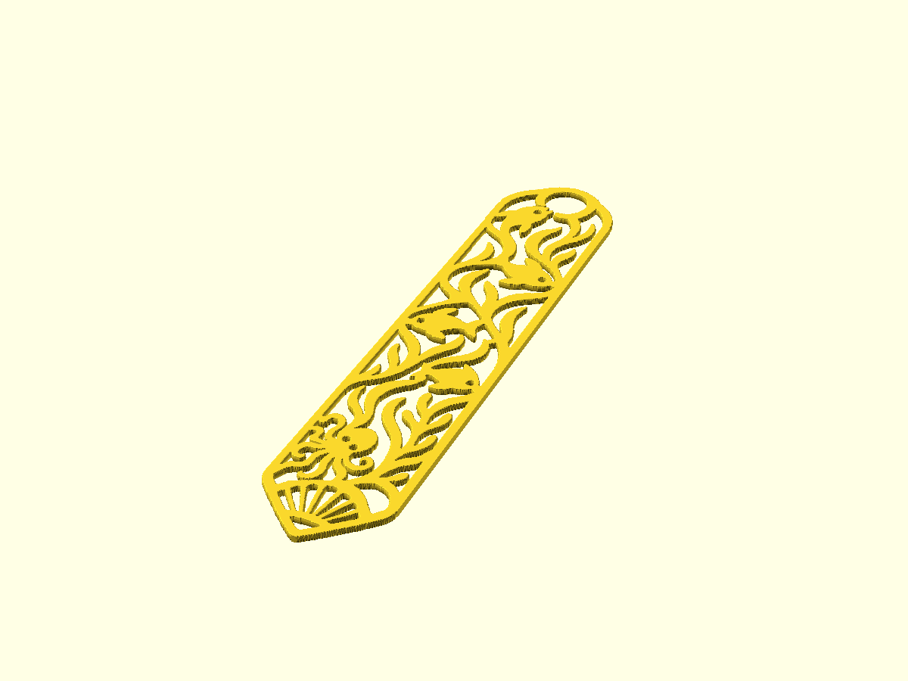

# bookmarks


<!-- previews:start (generated by previews.sh, do not edit) -->
### cat_bookmark.scad

```text
Cat pattern bookmark (source/cat_pattern.jpeg): lace-like cat and ornament,
the black areas of the artwork are cut through the plate.
Run ./prep_images.sh after changing the source image.
```



### fish_bookmark.scad

```text
Fish pattern bookmark (source/fish_pattern.jpg): fish, seaweed and an octopus
inside a pointed frame, the black areas of the artwork are cut through the plate.
The outline is cut from the thin black line around the source image.
Run ./prep_images.sh after changing the source image.
```



<!-- previews:end -->
