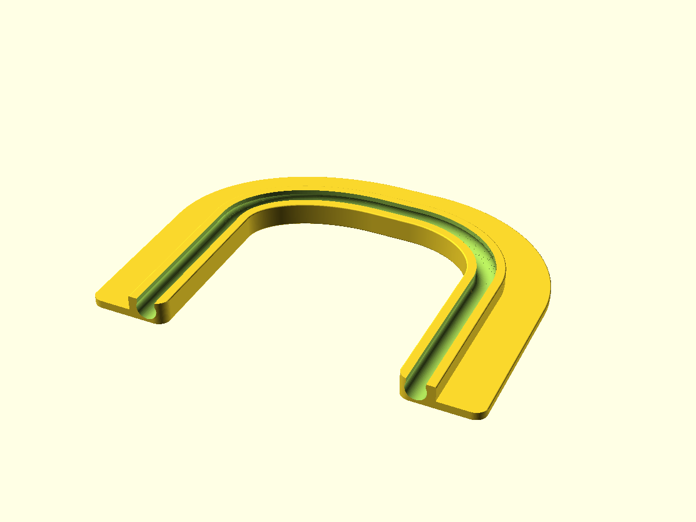
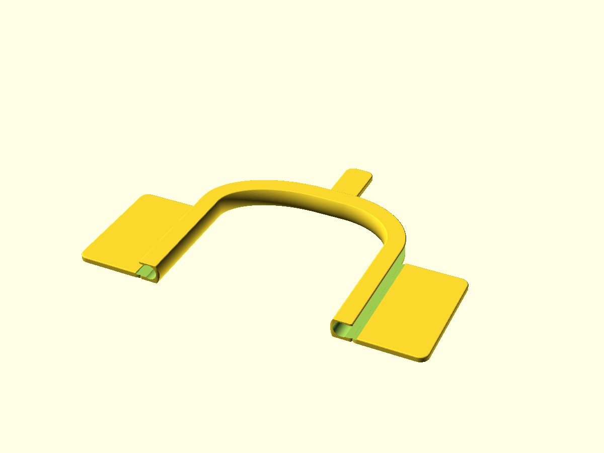

# doorcable

Thin U-shaped ethernet cable guide for the gap under a door.

`door_cable_holder.scad` (mk1) and `door_cable_holder_mk2.scad` (open top, flat base) share the parameter-set
files `*.json`: in OpenSCAD pick a set (`frontdoor`, `frontdoor_08`) in the Customizer.

<!-- previews:start (generated by previews.sh, do not edit) -->
### door_cable_holder_mk2.scad

```text
Thin ethernet cable guide for the gap under a door, mk2: an open-top channel on a flat base.
A U-shaped path lying flat on the floor: straight leg, elliptical bend, straight middle (goes under
the door), bend, straight leg. The cable is pressed into the channel from above and held by the
narrower opening. The channel has thick walls and a flat lip on the outer side of the U; channel and
lip together are tape_w wide, with a flat bottom: stick the double-sided tape straight onto it.
The tape adds tape_t under the door, so the part is gap_h - tape_t - clearance tall.
Print flat, base down: no supports.

Bend extents, mid_len and min_width are measured wall to wall, between the faces of the channel walls
that face the inside of the U (not along the centre line of the channel). Leg lengths are the
straight lengths.
```



### door_cable_holder.scad

```text
Thin ethernet cable guide for the gap under a door (print in PETG, or TPU for a softer snap-in).
A U-shaped strip standing on edge, lying flat on the floor: straight leg, elliptical bend, straight middle
(goes through the gap under the door), bend, straight leg. The cable clips into a channel that
opens towards the outside of the U (open_inside = true: towards the inside). The back is
slightly rounded.
The strip is gap_h - 0.5 tall and stands on the floor. A plate behind it, along the legs and the
middle, holds 20 mm tape in a recess on its underside, so the tape does not add to the height.

Parameters marked (measure) are worth checking against your door and cable.
```



<!-- previews:end -->
