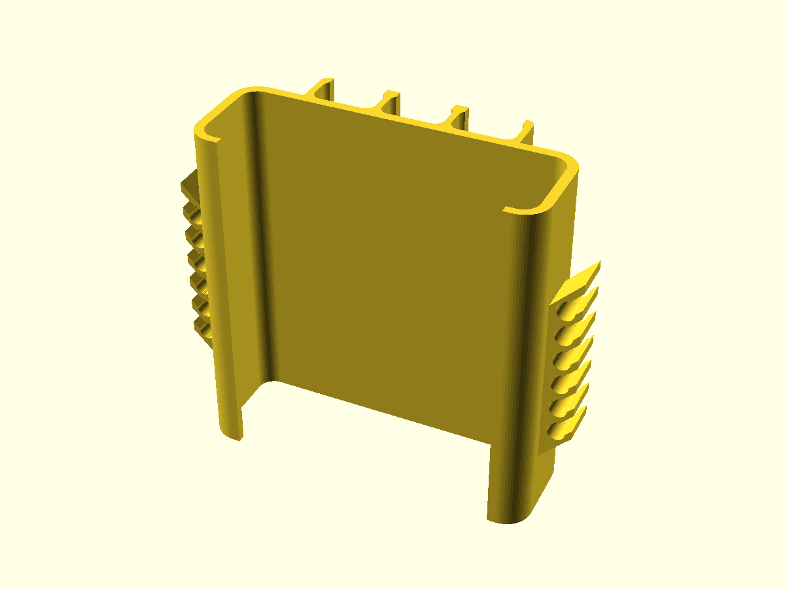

<!-- previews:start (generated by previews.sh, do not edit) -->
### powerbank_clip.scad

```text
Cable wrap holder for a power bank (print in PETG; TPU for a softer snap-in).
A sleeve slides over the power bank from one end, like a ring around its cross-section: a front plate,
two sides that follow the rounded corners, and a narrow lip on the back so it cannot fall off.
Bottom to top along the sleeve:
  USB-C zone    three snap-in clips in a row on the front plate (neighbours share a wall), plugs point down
  wrap zone     the cable is wound around the outside of the sleeve
  USB-A zone    three snap-in clips in a row, plugs point up
Each side wall carries a comb of cable channels (one per turn, neighbours share a wall): the cable is
wound around the sleeve and each turn is pressed into its channel through a narrow opening.
Print standing up (sleeve axis along Z), no supports: the comb walls and channel openings slope up by
comb_angle (45 degrees) going outwards, and the USB-A clips start with a 45 degree ramp from the plate.

Parameters marked (measure) are worth checking against your power bank, cable and plugs.
```



<!-- previews:end -->
